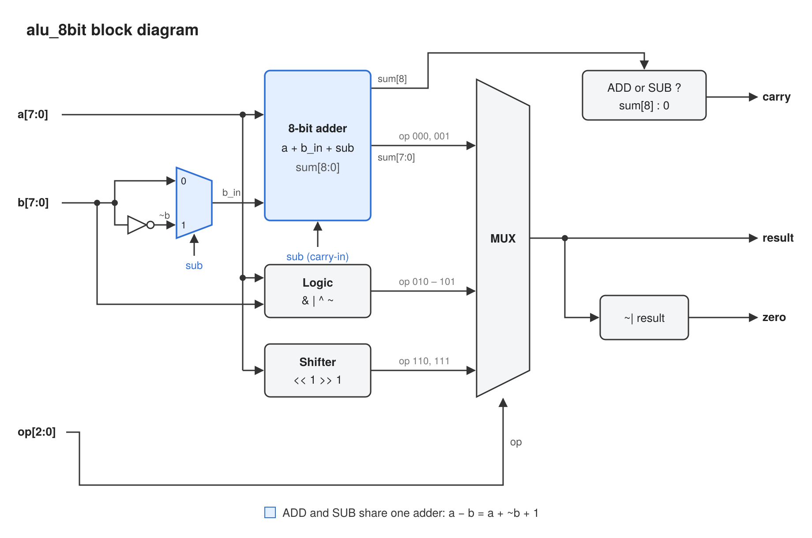
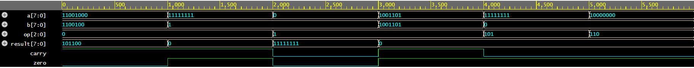

# 8-Bit Arithmetic Logic Unit (ALU)
**Author:** Elroi Sluk

## Overview
This project is the design and verification of an 8-bit combinational ALU in SystemVerilog. It supports eight operations with carry and zero flags. The work started from a written specification, moved to RTL design, and ended with a self-checking testbench that verifies every possible input combination against a reference model.

## 1. Specification
The ALU takes two 8-bit unsigned operands (`a`, `b`) and a 3-bit opcode (`op`), and returns an 8-bit `result` with two status flags.

| op  | Operation | result | carry |
|-----|-----------|--------|-------|
| 000 | ADD | a + b | carry out |
| 001 | SUB | a - b | 1 if no borrow (a >= b) |
| 010 | AND | a & b | 0 |
| 011 | OR  | a \| b | 0 |
| 100 | XOR | a ^ b | 0 |
| 101 | NOT | ~a | 0 |
| 110 | SHL | a << 1 | 0 |
| 111 | SHR | a >> 1 | 0 |

`zero` is 1 whenever the result is 0.

## 2. Architecture
The adder, the logic operations and the shifter work in parallel, and a multiplexer driven by the opcode selects which result reaches the output.



The main design decision is that **ADD and SUB share a single 8-bit adder**. Subtraction uses two's complement, `a - b = a + ~b + 1`: when the opcode is SUB, `b` is inverted and the carry-in is set to 1. This saves a separate subtractor, and the carry-out of the same adder serves as the carry flag for both operations (for SUB, carry = 1 means no borrow).

## 3. RTL Implementation
The design (`rtl/alu_8bit.sv`) is written in SystemVerilog:
* **Shared adder:** three continuous assignments select `b` or `~b` and compute a 9-bit sum, where bit 8 is the carry.
* **Operation select:** a `case` on the opcode inside `always_comb` chooses the result.
* **Latch-free logic:** every output gets a default value at the top of the `always_comb` block, so every path through the `case` assigns it.
* **Zero flag:** a NOR reduction of the result, `zero = ~|result`.

## 4. Verification & Simulation
Because the input space is small (256 × 256 × 8 = 524,288 combinations), I chose **exhaustive** verification instead of random sampling: random tests can miss boundary cases, while a full sweep checks every one of them.

The self-checking testbench (`tb/tb_alu_8bit.sv`) is built from two parts:
* **Reference model (`function`):** computes the expected `result`, `carry` and `zero`. It calculates SUB with `a - b` and `a >= b`, independently of the shared-adder logic, so a bug in the design would not be copied into the expected values.
* **Checker (`task`):** drives one input vector, waits, and compares all three outputs to the model using `!==`, so unknown (X) values are caught as errors. It prints the first 10 mismatches and counts all of them.

The test runs six directed corner cases first (carry out, wrap to zero, SUB with and without borrow, NOT 255, and a left shift that drops the MSB), then the full sweep. It ends with the number of checks and a PASS/FAIL summary:

```
Checks run: 524294
*** TEST PASSED ***
```

To make sure the testbench can actually detect bugs, I broke the design on purpose (replacing AND with OR) and confirmed that it reports `TEST FAILED`.

### Waveform
Simulated with **Icarus Verilog** on EDA Playground and reviewed in **EPWave**. The waveform shows the six corner cases (the full sweep is not dumped, to keep the file small).  


